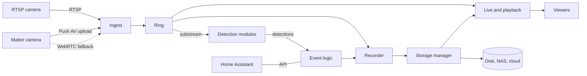

# Camera Assistant architecture

Read this first if you are new to Camera Assistant, as a person or as a coding agent. Each area links to its detailed plan in `docs/plans/`. "Camera Assistant" is a working title.

## What it is, and what it is not

Camera Assistant is a local recorder for the cameras in a home. It is one server process that handles everything that touches video: ingest, live view, recording, object detection and playback.

- It is built for Home Assistant first and also works on its own, like the Matter Server and Z-Wave JS: a dedicated server with its own API and interface, driven from Home Assistant.
- It is plug and play, and light enough for a Home Assistant Green or a Raspberry Pi. It does more on stronger hardware.

It is not a replacement for Frigate, which serves people who want every option. It never transcodes video to record it. It has no mobile app: notifications, remote access and the apps belong to Home Assistant. It has no brand-specific camera code: the camera's own integration in Home Assistant stays its owner and hands the stream over.

## Principles

- **Home Assistant owns devices, Camera Assistant owns media.** Everything that touches video bytes lives in Camera Assistant.
- **One connection per camera,** passed on to every consumer without transcoding.
- **No knobs.** The server measures the host and picks models and rates itself. A person chooses what to record, where and for how long.
- **Local first.** Every feature works with local storage. A cloud is one kind of location among others.
- **Standalone engine.** The server never calls Home Assistant and holds no credentials for it. It keeps recording while Home Assistant restarts.
- **One owner per camera.** With Home Assistant, its integration owns the camera. Without it, the server adds the camera itself. Never both.

## Who owns what

| Area | Home Assistant | Camera Assistant |
|---|---|---|
| Adding a camera, credentials, control (PTZ, privacy, lights) | The camera's integration | Receives the stream source |
| The camera's own events (motion, person, doorbell) | Entities | Uses them as triggers |
| Live view and playback | Player, signalling, Media browser | Serves the video |
| Recording, storage, detection | A switch per camera, status, results as entities and events | Does the work |
| Automations and notifications | Runs them | Sends the events |
| Camera interface: overview, events, timeline, settings | Shows it as a panel | Builds and serves it |

## The parts of the server

The server is written in Rust. Detection modules run as separate processes next to it. Plan: [docs/plans/server-foundation.md](plans/server-foundation.md).

| Part | What it does |
|---|---|
| Ingest | An RTSP client for main stream and substream, an HTTPS endpoint for Matter Push AV uploads, and a WebRTC peer for cameras that offer nothing else. |
| Ring | Per camera, the last seconds of video in memory as fMP4 fragments. Supplies pre-roll and feeds live viewers. |
| Recorder | Writes continuous segments and event clips, with an index in SQLite. The files describe themselves, so the index can be rebuilt from disk. |
| Storage manager | Locations, rules, retention and background copies. |
| Live and playback | WebRTC for live view, HLS over the stored segments for recordings, MP4 for download. |
| Event logic | Combines triggers from the camera, Home Assistant, the motion check and detection into events with a start, an end and labels. |
| Detection modules | Separate processes, one per kind of hardware. Compressed substream in, detections out. |
| API | WebSocket and HTTP with a versioned schema, for cameras, modes, storage, events, playback and health. |
| Web interface | The full camera interface, served by the server. |

The ring holds compressed video only. The recorder and live view pass it on unchanged. Only a detection module decodes video, and only the small substream. A crash in a detection module costs detections, never recordings. Each camera runs in its own supervised task, with a watchdog for streams that stall silently. The API and the web interface require authentication.

## Cameras

**RTSP cameras** ([docs/plans/rtsp-ingest-and-ring.md](plans/rtsp-ingest-and-ring.md)). The server connects to the camera itself, for the main stream and the substream where there is one. H.264 and H.265 video and AAC and Opus audio are recorded as they arrive. G.711 audio is converted, which is cheap. With Home Assistant, the camera's integration hands over stream addresses, credentials and trigger entities through the API. Without it, a person enters the stream address in the web interface.

**Matter cameras** ([docs/plans/matter-cameras.md](plans/matter-cameras.md)). Matter defines one thing for recording: a camera can be told to upload its video to an HTTPS address. This is Push AV. The camera sends CMAF segments with HTTP PUT over mutual TLS. Camera Assistant is that address. It talks to the Matter Server over its WebSocket, next to Home Assistant, and through it:

1. installs the root certificate of its own small certificate authority on the camera, and signs and installs the camera's client certificate;
2. registers its host and port on the camera;
3. sets up the upload with a trigger that fits the recording mode: continuous, motion, or on command;
4. follows the camera's session and zone events to build its index.

Push AV is optional in Matter. For a camera without it, the server holds a WebRTC session for recording. Live view of a Matter camera is WebRTC. The Matter Server needs support for the Push AV and TLS clusters and a camera API for a second client. Open points that need real cameras: whether a camera accepts a local IP address as upload host, how cameras keep their clocks in sync, and how complete Push AV is in shipping cameras.

## Live view and playback

Plans: [docs/plans/live-view.md](plans/live-view.md), [docs/plans/recorder-and-playback.md](plans/recorder-and-playback.md).

A client asks for a camera at a moment, now or in the past, and gets back the ways it can be played. Many cameras allow only one or two streams at once; the server takes them once and serves any number of viewers.

| Use | First choice | Otherwise |
|---|---|---|
| Live view, RTSP | WebRTC from the ring: lowest delay, and works away from home without Home Assistant Core carrying video. | fMP4 over a WebSocket, for codecs and audio WebRTC cannot carry. |
| Live view, Matter | Until after the MVP: the camera's own WebRTC session straight to the viewer, as today. Then: one session to the server, passed on to every viewer. | Near-live from a continuous Push AV upload. |
| Recordings | HLS over the stored segments. They are CMAF already, so nothing is converted. | WebRTC when the client cannot reach the server. MP4 for download and notifications. |

### Native first, transcoding last

Recording never transcodes. For viewing, the server goes down this ladder only as far as it must:

1. The native stream, when the client can decode it.
2. Another native stream: the substream, often H.264, or a second H.264 stream from a Matter camera.
3. The same video with converted audio or in another container. This is cheap.
4. Transcoded video, for one viewer while they watch. It needs a hardware encoder and comes after the MVP.

To keep step 4 rare, the server can also record the substream, and the setup check flags a camera that sends H.265 on every stream.

## Storage

Plan: [docs/plans/storage-locations.md](plans/storage-locations.md).

Storage works like backups in Home Assistant: the household picks locations and sets rules. A location is either a file system the server is given, or a cloud connector.

- In Docker, file systems are volumes and bind mounts. Network shares are mounted on the host.
- On Home Assistant OS, they are the mounts the Supervisor grants to apps: the data disk, a USB drive, or a NAS share set up once in Home Assistant.
- Cloud connectors use an open interface, so others can add their own.

Inside the server a location is a small interface: write, read a range, list, delete, report free space. A rule says what, where and how long, such as "person events, local disk, 30 days, at most 50 GB". The server writes to one primary location and copies to the others in the background, queuing copies while a location is offline. When a disk fills up, the oldest footage goes first and Home Assistant shows a repair. Uploads to a cloud are encrypted before they leave the house.

A 1080p camera at 2 to 4 Mbit/s fills about 20 to 45 GB a day when recording continuously. The 32 GB inside a Home Assistant Green is enough for event clips; continuous recording needs a USB drive or a NAS.

## Detection

Plan: [docs/plans/detection.md](plans/detection.md).

Recording only rewraps the stream, so it runs on every box. Detection decodes video and runs a model, so it scales with the hardware.

**The module contract.** A detection module is a separate process for one kind of hardware. It receives a camera's compressed substream and returns detections: label, score, box and timestamp. Decoding, scaling and inference stay inside the module. It reports its devices, models and the rate it measured. The detection plan defines the exact messages. This seam keeps closed vendor libraries out of the server and driver crashes away from recordings, and lets the people who own a kind of hardware release its module. Every module passes a conformance kit: reference clips, the detections they must produce, and a time budget.

The first detection engine comes from [Cairn](https://github.com/bbangert/cairn-nvr), whose author donates it. Models come from the YOLOX family (Apache 2.0) and are downloaded at first start. What the server picks by itself stays within permissively licensed models. A model under a copyleft licence can only be an optional download that a person chooses.

**How it scales by itself.** The server measures the host and works out how much analysis it can sustain for the number of cameras. Nobody picks a model, and the server steps down by itself when cameras are added. It uses the highest step it can sustain:

1. The camera's own events, such as person events from a Reolink camera or motion per zone from a Matter camera. They cost nothing.
2. A motion check on the substream.
3. Object detection only when something moves.
4. Continuous object detection.

**Three tiers.**

| Tier | What it does | When |
|---|---|---|
| 1. Presence | A person, pet, vehicle or package is there. | MVP |
| 2. Tracking | Follows objects across frames and knows when one stops. Needs stronger hardware. | After the MVP |
| 3. Recognition | Faces and licence plates. Optional and local. | Later |

Labels and zones follow Matter's tag lists. The Matter 1.7 draft adds an [AV Analysis Node](https://github.com/project-chip/connectedhomeip/blob/master/data_model/1.7/device_types/AVAnalysisNode.xml) device type that analyses camera streams and reports what it sees as Matter events. Camera Assistant aims for that role once the specification is final.

**Hardware targets.**

| Target | Where the module lives | Phase | State today |
|---|---|---|---|
| CPU (ONNX Runtime) | Main repository | MVP | The baseline on every box, with small models. |
| Intel graphics (Quick Sync, OpenVINO) | Main repository | MVP | Open drivers and runtime. About half of the Home Assistant OS installs in the [analytics](https://analytics.home-assistant.io/) are x86. A virtual machine needs the graphics device passed through. |
| Home Assistant Green NPU (RK3566) | `camera-assistant-rockchip` | MVP | Cairn has an RKNN backend. It needs a kernel driver that Home Assistant OS does not ship today; the route is being worked out with the Home Assistant OS maintainers ([operating-system#3089](https://github.com/home-assistant/operating-system/issues/3089)). Until then the Green uses camera events and the CPU. |
| Qualcomm QCS6490-class NPU | `camera-assistant-qualcomm` | After the MVP | Cairn has a QNN backend. Needs Qualcomm's closed runtime. |
| Hailo, NVIDIA, others | Open to the community | After the MVP | Not started. |

Closed vendor libraries live only in hardware modules. Where a licence does not allow shipping them, they are downloaded on first start and checked against a pinned checksum.

## The Home Assistant side

Plans: [docs/plans/home-assistant-integration.md](plans/home-assistant-integration.md), [docs/plans/web-interface.md](plans/web-interface.md), [docs/plans/recording-provider-platform.md](plans/recording-provider-platform.md).

**The integration.** A Python client library talks to the server's WebSocket, as Home Assistant does with the Matter Server. The integration installs and starts the app, hands over cameras (from the MVP), adds a recording switch, an event entity and the last event per camera, offers a `record_clip` action, and shows recordings in the Media browser. The camera interface is built once in the `frontend` repository and shown as a panel. Its player and timeline are web components that dashboard cards can reuse later.

**The recording provider platform.** Today each recording system brings its own way to show recordings in Home Assistant, and the video often passes through Home Assistant Core. We propose a generic recording provider platform for Home Assistant Core, through Home Assistant's architecture process. Camera Assistant is its first provider; Frigate or a Reolink hub could implement it too.

- Required: list events in a time window, get a playback handle, get a thumbnail.
- Optional: push events, a timeline of recorded spans, seek and preview, delete and protect, configure, storage status.

A playback handle says where and how to play something, never the video itself. The client tries HLS straight from the provider on a short-lived signed address, then WebRTC signalled through Home Assistant, and only as a last resort a plain pass-through in Core.

**The media gateway role.** A media gateway outside Core turns video a browser cannot play, such as an RTSP replay, into WebRTC or HLS. go2rtc has this role today and keeps it where Camera Assistant is not installed. Where it is installed, Camera Assistant takes over step by step: first live view for its own cameras, later playback for other recording systems. go2rtc stays as the fallback for protocols Camera Assistant does not speak.

## Repositories

| Repository | Contents | Language |
|---|---|---|
| `camera-assistant/camera-assistant` | The server, the CPU and Intel detection modules, the conformance kit | Rust |
| `camera-assistant/frontend` | The web interface and its web components | TypeScript |
| `camera-assistant/backlog` | This document, the plans, the issues, the project board | Markdown |
| `camera-assistant/camera-assistant-rockchip`, `camera-assistant/camera-assistant-qualcomm` (later) | Detection modules for one kind of hardware | Rust |

The Home Assistant side is Python. The licence is Apache 2.0. Setup of the repositories: [docs/plans/project-setup.md](plans/project-setup.md). The project is developed in the open and AI-first: every task carries enough context for a person or a coding agent to start, and a maintainer reviews every change.

## Phases

**Preview**, shown as a Labs feature in Home Assistant. Matter cameras and RTSP streams record to local and network storage, on the camera's own events or continuously, with pre-roll and retention. Cameras are set up in the server's own web interface. Recordings show in Home Assistant's Media browser, and there is a `record_clip` action. Live view stays on Home Assistant's current path. It ships as a Home Assistant app for aarch64 and x86-64, and as a container.

**MVP**, the first release for everyone. Setup from Home Assistant. Tier 1 detection on the CPU, Intel graphics and the Green's NPU. Live view for RTSP cameras through the server. The interface as a panel. A cloud copy of events through an open connector interface. WebRTC recording for Matter cameras without Push AV, protected clips, and repairs for full or missing storage.

**After the MVP.** A timeline with scrubbing, dashboard cards, full storage rules, more connectors and hardware modules, Matter live view through the server, tracking, and the Matter AV Analysis Node role.

## Glossary

| Term | Meaning |
|---|---|
| App | A program that Home Assistant OS runs next to Home Assistant, in its own container. |
| CMAF, fMP4 | MP4 cut into small fragments. Camera Assistant stores and serves video in it. |
| HLS | Video played over plain HTTP from a list of segments. |
| NPU | A chip, or part of one, that runs detection models fast and with little power. |
| Pre-roll | The seconds before an event, taken from the ring. |
| Push AV | The Matter way for a camera to upload video to a recorder over HTTPS. |
| Substream | A second, smaller stream from the camera, used for detection and small views. |
